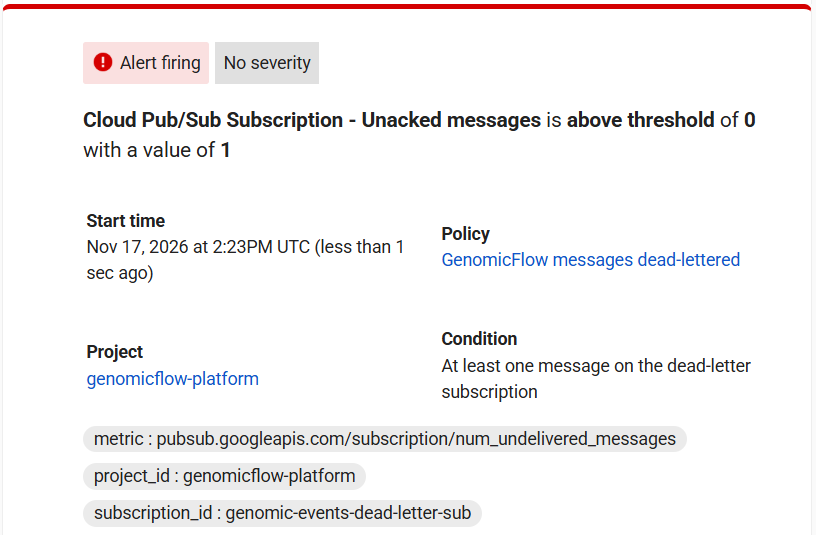

# Evidence

Output of `scripts/verify_gcp.sh` against the `genomicflow-platform` GCP project, copied verbatim from the terminal. Both runs used the v0.2 Terraform, applied on 17 November 2026 (8 added, 0 changed, 1 destroyed).

| File | Pipeline mode | Result |
|------|---------------|--------|
| [gcp-verify-2026-11-17-run1-drain-mode.txt](gcp-verify-2026-11-17-run1-drain-mode.txt) | Started and stopped in 16 short rounds | 5 of 6 checks passed. The unstorable run was retried in 15 rounds and never dead-lettered. |
| [gcp-verify-2026-11-17-run2-listen-mode.txt](gcp-verify-2026-11-17-run2-listen-mode.txt) | One listener for the whole check | 6 of 6 checks passed. The unstorable run was delivered 5 times (attempts 1 to 5), then dead-lettered within 45 seconds. |

Why the first run failed: with nothing listening between rounds, Pub/Sub's delivery count can reset to zero, so the message never reached the 5-attempt limit. The dead-letter policy and IAM grants were correct, and were checked during the run. The fix was listen mode (`run_pipeline(run_seconds=...)`), added in PR #4.

The "Pub/Sub waits 10s, 20s, 40s..." line in run 2 was the script's own expectation. In practice the five attempts came within 45 seconds; the subscription's retry policy allows 10 to 300 seconds between attempts.

## Alert email

The "GenomicFlow messages dead-lettered" alert emailed the data-team address at 14:23 UTC. Run 2 had dead-lettered the test message at about 14:12 UTC, so the email arrived roughly 11 minutes later. Pub/Sub metrics reach Cloud Monitoring with a delay, and the condition also waits 60 seconds.

Not covered: the Cloud Run API.
